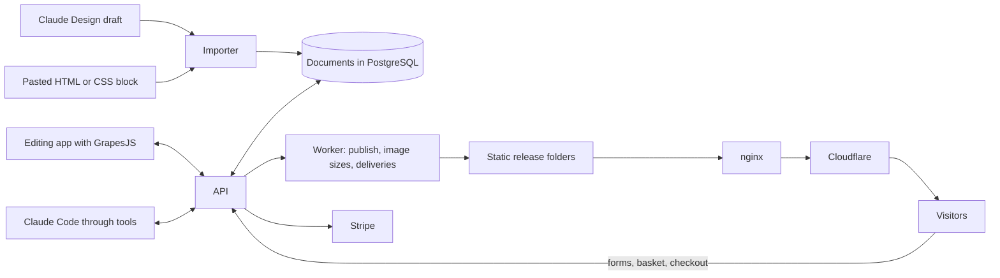

# Web engine to replace WordPress: architecture proposal and roadmap

**What this is.** The architecture for Small Giants Studio's own website engine and the gated steps to build it. Bean approved it on 2026-11-12 after a research round and a full council (four independent reviews, every finding checked by a separate fact-checker). Nothing is built yet: section 21 is the brief that starts step 1a in a new repository. The research behind it is in `C:\Users\Bean\.claude\memory\research\2026-11-12-web-engine-replace-wordpress.md`.

**How to read it.** Section 1 is for Bean. Sections 3 to 15 are the design. Section 16 is the roadmap with pass and stop conditions. Section 20 maps every part of the system to its section and says how settled it is.

## 1. Summary for Bean

**Verdict.** Build it, in gated steps. No reviewer found a better route to the three principles below.

**The insight.** A Claude Design draft already holds the finished look: every style, at every screen size and state, readable from its source. The month per site on WordPress went on re-expressing that look as block settings, because WordPress needs every setting to be built, block by block. An editor that works on a page's HTML and CSS directly can show any CSS property as a setting, at every screen size, with no code per component, and a draft's structure and styles can be carried into it as they are. What a draft does not hold is production behaviour: its basket, account and forms are stand-ins. So the look is nearly free and the behaviour is the real work.

**The three principles (Bean, 2026-11-12).**

- **Claude Code can change everything.** Content, pages, styles, media, products, theme and publishing go through validated tools. The visual editor is the human view of the same data.
- **One-for-one.** A design's look is carried across as it is, copy-and-paste style. Its behaviour is rebuilt from the draft's own inventory of menus, forms and states, using a small library of reusable behaviours. Open-source blocks paste in the same way. The type of site does not limit the front end.
- **Every setting, without building each one.** Style control comes from the editor's own style panel, not from controls written per component.

**The system.**

| Part | Choice |
|---|---|
| Visual editor | GrapesJS core 0.23.9 (BSD licence), with our own panels |
| What a page is | An HTML and CSS document stored as data, with included parts, smart parts and versions |
| Engine room | Small open-source parts we own: PostgreSQL, Drizzle, Better Auth, pg-boss, the official MCP kit, Hono |
| Public pages | Plain static files written by our publisher, served by the nginx already on the VPS, cached by Cloudflare |
| Editing app | A simple web app plus one small API |
| Hosting | The existing Hostinger VPS, Docker Compose, builds in GitHub Actions |
| Client domains | Cloudflare for SaaS through a Cloudflare Tunnel |
| Design intake | An importer that carries a draft's look in one-for-one, and a paste importer for any HTML, CSS or Tailwind block |

**Decisions Bean made (2026-11-12).**

1. Everything is controllable in the visual editor, and the control comes from the editor. Clients open a content mode by default and the agency a design mode; design mode can be switched on per client.
2. The engine room is ours, assembled from small open-source parts. Not Payload.
3. WordPress framework development is frozen: security updates and client fixes only. Indus and Eye Care launch on WordPress as signed off. Mama's is the proof site on the engine, and its hand-finishing on WordPress has stopped.

**A choice still open to flip.** The scope reviewer would prove a pure brochure site first (Indus's draft is ready). Mama's was kept because Bean chose it and because its Home, Contact and Help pages give the same brochure proof in step 1b.

**What Bean sees first.** In about 10 build hours: Mama's homepage and shop page, with header and footer, imported from the existing draft, looking right at four screen widths, editable with the full style panel, published on a test address, speed measured. Nothing interactive works at that point.

**On time.** The timeboxes in section 16 are the smallest plausible figures. The scope reviewer expects two to three times longer. Each step's stop limit is set at the reviewer's figure, so the first slice shows which is right.

## 2. Problem

Measured in this repository on 2026-11-12:

- The WordPress framework has taken 12,949 commits since 12 February 2026 (`git rev-list --count HEAD`). It holds 101 blocks carrying 13,081 settings, and about 100,000 lines of tooling (`scripts/computed-route`, `scripts/parity`) that turn a finished design into block settings.
- From design handoff to sign-off, Indus took 28 days and 117 hand-checked items over 11 rounds, and Eye Care took 32 days and 15 rounds (`plans/2026-11-02-clone-finishing-streams.md`). On 2 November the automatic route was rewound because the clones built on later code were further from their drafts (`plans/2026-10-30-clone-recognition-fixes.md`).
- Pages on the two measured test sites ship 82 to 379 KB of JavaScript and 55 to 160 KB of CSS (`scripts/data/page-weight.json`), against the project's own budget of 50 KB and 100 KB.
- The agency sells builds at £1,800 to £4,500 with care plans from £75 a month, and its pitch is speed.

The cost sits in one mechanism: every visual difference between a design and the framework had to become a block setting with its own control, renderer and calibration. The engine removes that mechanism instead of speeding it up.

## 3. System overview



**Data flow.**

1. A draft arrives as a handoff folder (Spec 48A). The importer reads its look and writes documents.
2. People edit documents in the editing app; Claude edits the same documents through tools. Every save is a version.
3. Publish builds a new static release for one site, validates it, switches to it, and purges that site's pages at Cloudflare.
4. Visitors get files. Only forms, baskets and checkout call the API.

**Integration surfaces.** The document format (section 4); the tool list (section 9); the published release layout (section 8); the handoff folder (Spec 48A, unchanged); Stripe notifications (section 12.3); delivery of form entries to a mailbox, HubSpot or n8n (section 12.2).

## 4. The document format (version 0)

This is the contract the importer, the editor and the publisher are built against. It is version 0: step 1a's round-trip test (4.11) either confirms it or changes it before anything else depends on it.

**4.1 Storage units.** A site has settings (name, breakpoints, theme tokens, business details, allowed outside hosts), one site style sheet (resets, body, focus ring, keyframes, the helper classes in 4.2), and documents. A document is a `page`, a `part` (header, footer, card, any reusable piece) or a `template` (a page pattern filled from one collection item, such as a product page). Each document stores:

- `formatVersion`, `kind`, `slug`, and for pages its details (4.8);
- `tree`: the element tree as GrapesJS component JSON;
- `rules`: the GrapesJS style rules that target this document's own classes;
- `version` (a number that rises on every save) and `publishedVersion`.

When the editor opens a document, the API composes a GrapesJS project from the site style sheet, the document's tree and rules, and read-only copies of the parts it includes. On save the editor returns the tree and rules of that document only.

**4.2 Naming and style targets.**

- Every element carries one own class, `<doc>-<n>`: `<doc>` is the document's short code and `<n>` the draft's template id, so `home-142`. A name the designer gave (`data-part="hero-cta"`) replaces the number: `home-hero-cta`. Elements repeated from the same template element share the class.
- The template id is also kept as `data-t="142"`, which is what a re-import pairs on (4.13).
- Rules target classes only. Ids are never styled, and no stored or published HTML carries an inline `style` attribute.
- Values stay literal on import. Mapping them to tokens is a reviewed step after the look passes (section 6).
- A short fixed list of helper classes lives in the site style sheet: `u-only-m`, `u-only-t`, `u-only-d`, `u-from-t`, `u-hidden`, `u-visually-hidden`.

**4.3 Screen sizes.** Breakpoints are a site setting, mobile-first: the base rule is the smallest size and each breakpoint is a `min-width` media rule. Mama's uses `tablet: 768` and `desktop: 1024` on every page. GrapesJS is configured with `mediaCondition: 'min-width'` and one device per breakpoint.

**4.4 States.** Hover, active and focus-visible are ordinary pseudo-states. Looks that depend on behaviour are classes with an `is-` prefix: `is-on` (selected or pressed), `is-open`, `is-current`, `is-invalid`, `is-loading`. A rule for a selected chip is `.shop-38.is-on`. Behaviours switch the class and the matching ARIA attribute together. The style panel lists these states so a selected or open look can be edited like any other.

**4.5 Included parts.** A page includes a part by reference:

```html
<sgs-include part="site-header" data-current="shop" class="shop-18"></sgs-include>
```

- In the editor the include shows the part read-only, with an action to open the part itself.
- At publish the tag is replaced by the part's tree and the part's rules are added. `data-current` marks the element in the part whose `data-nav` matches: it gets `is-current` and `aria-current="page"`.
- Styles that belong to the mount (Mama's header is pinned with `position: sticky; top: -32px` on the mount, not inside the header) stay on the include's own class.
- GrapesJS's own "symbols" are beta with no screen and document property overrides only, so they are not used.

**4.6 Data nodes.**

```html
<div class="shop-46" data-repeat="products" data-filter="cats~zookies" data-sort="featured" data-limit="12">
  <sgs-include part="product-card" class="shop-48"></sgs-include>
</div>
```

- `data-repeat="<collection>"` on a container: its first child is the template, cloned once per item at publish. Optional `data-filter`, `data-sort` and `data-limit`.
- `data-field="<name>"` fills an element's text. `data-field-attr="src:image,alt:imageAlt,href:url"` fills attributes. `data-if="<name>"` and `data-unless="<name>"` keep or drop an element.
- Items are JSON validated by their collection's schema.
- In the editor the template is shown once, filled with the first item.
- Lists that filter or sort in the browser use the same markup plus a published index file (`/data/<collection>.json`) read by the filter behaviour.

**4.7 Smart parts.** Behaviour is attached in one of two ways: a custom tag (`<sgs-drawer>`, `<sgs-carousel>`, `<sgs-form>`) or, where a behaviour decorates existing elements, an attribute (`data-sgs="reveal"`). Settings travel as attributes or one `data-settings` JSON value. Each smart part has exactly one behaviour file (`behaviours/<name>.js`: a plain browser module with no dependencies unless its card lists one), loaded only on pages that contain it and never in the editing canvas, and a one-page card (section 7.3).

**4.8 Page details.** `title`, `description`, `path`, `canonical` (optional), `socialImage` (optional), `noindex` (optional), `navKey` (which navigation entry is current).

**4.9 Assets.** Images are referenced by media id: `" alt="…" width="…" height="…">`. The publisher writes `src`, `srcset`, `sizes`, `loading` and `fetchpriority` from the media record and the page's priority-image flag. A background image in a rule is written `url(media:<id>)` and rewritten at publish.

**4.10 Format version and migrations.** Every document carries `formatVersion`. A migration is a pure function from one version to the next, kept in one folder and run when a document is read. A test loads every saved fixture through every migration.

**4.11 Round trip.** Loading a stored document into headless GrapesJS and exporting it must reproduce the published HTML and CSS exactly, and exporting, importing and exporting again must be stable. This is a publish check and one of step 1a's pass conditions.

**4.12 Unsupported markers.** Where the importer cannot carry something, it sets `data-unsupported="<code>"` on the element and writes an entry in the import report with the draft location and the reason. Codes: `measured-layout` (layout computed from measurements in JavaScript), `code-built` (elements created by script), `formula` (a value that varies continuously and is not plain CSS), `runtime` (an unrecognised draft runtime, which stops the import).

**4.13 Re-import after a design change.** Elements pair on `data-t`. Structure, classes and rules belong to the design and are replaced. Text, images, links and field values belong to the client and are kept. A client-owned value whose element no longer exists goes to a review list instead of being dropped. The tooling is built in step 2; the pairing key and the ownership split are fixed now so no document is stored without them.

## 5. The editor

**5.1 GrapesJS core and what we add.** GrapesJS core 0.23.9 is BSD 3-clause, has 26.4k stars and ships a release every one to four weeks. `@grapesjs/react` (MIT) replaces its dated default screens with our own panels. Built in: the style panel, screen sizes, states, layers, an image manager, multiple pages, undo, storage hooks, per-element locks, and a mode that runs with no browser (`headless: true`, covered by its own test suite). Ours to build: the panels, the two modes, a tokens panel, the include and repeat node types, and a small PostCSS parser adapter (the published `grapesjs-parser-postcss` dates from 2023 and the default parser loses declarations).

**5.2 Design mode.** The style panel is configured with the properties drafts actually use. `grid-template-columns`, `gap`, `aspect-ratio`, `inset`, `translate`, `scroll-snap-*` and `clip-path` are missing from its default sectors and are added by listing them (an unlisted property name becomes a text field). One free "any property" row covers whatever is not listed. `componentFirst` is off, so edits land on the element's class and repeated elements change together.

**5.3 Content mode and roles.** Content mode is decided by element type, not by hand: text, images, links, the items of a repeat and collection fields are editable; structure, classes and rules are locked through GrapesJS's own flags (`editable`, `stylable`, `draggable`, `removable`, `locked`). The server applies the same limits to every save and tool write, comparing the incoming tree with the stored one, so a crafted request cannot do what the mode forbids. Roles: owner (agency), designer (design mode), editor (content mode), viewer.

**5.4 Canvas rules.** No behaviour file runs in the editing canvas. An editor-only style sheet makes reveals visible, unpins sticky elements and gives `100vh` a fixed base, so every element can be selected. Previews and published pages are where behaviour runs.

**5.5 Screens in version 1.** Three working screens: the editor (pages, parts, layers, style panel, tokens), media, and an inbox for form entries and orders. One owner-only settings page holds the actions that are deliberately not tools (9.3): people and roles, domains, mail and payment credentials, script permission and deleting a site. Everything else (sites, redirects, collections, settings) is done through Claude until a client needs a screen.

**5.6 Known weak spots and the exit path.** Absolutely positioned elements, drag and drop on touch and Safari, and a basic text editor are weak in GrapesJS, and it has one main maintainer whose newer features (collections, a global styles panel, an AI assistant) go into a paid SDK that this design does not use. Its telemetry option is set to `false`, and the editing app's security policy blocks requests to unlisted hosts. The licence allows a fork. Every document exports to plain HTML and CSS with the include and repeat markers intact, so the editor can be replaced without losing a site. Editor speed on a 250-element page is measured in step 1a.

## 6. Theme tokens

One `theme.config.json` per site, stored with the site, in the W3C Design Tokens format (first stable version October 2025): raw values (palette, type scale, spacing, radii, shadows, easings), roles (surface, text, accent, border, focus ring) and a few part-level tokens. It compiles to CSS variables in the site style sheet.

- The style panel offers tokens first, then free values.
- Mama's draft uses no CSS variables: colours are literal hex values and its `tokens/` files are not referenced. So the importer keeps literals, and a separate reviewed step proposes replacing exact matches with tokens once the look has passed. Changing a brand colour once then updates every use.
- Contrast is checked and reported, never blocked (Bean's standing ruling).
- Fonts are downloaded, subset and self-hosted with fallbacks matched for size, so a late font does not shift the page.
- Carries over: the token vocabulary in Spec 32 Part C and each `sites/<client>/theme-snapshot.json`.

## 7. Design intake

**7.1 The reader (exists).** `scripts/computed-route/lib/read-logic.mjs`, with `read-logic-statics.mjs` and `read-logic-conditions.mjs`, runs a draft in a sandboxed browser page and resolves the value of every template element at each screen width and in each state, through the draft's own logic. Every rendered element carries the draft's template id (`data-dc-tpl`), shared by elements a loop repeats. None of this has WordPress code. `scripts/computed-route/lib/intake-breakpoints.mjs` finds a draft's width thresholds from its logic.

**7.2 The writer (new).** It turns the reader's output into documents.

| In the draft | Becomes |
|---|---|
| An element with a plain `style` | The element with its own class and one base rule |
| A style value that depends on screen size | Read at each breakpoint: the smallest size is the base rule, and each breakpoint rule holds only what differs |
| `style-hover`, `style-active` | `:hover` and `:active` rules on the own class, keeping the draft's priority over selected looks |
| A style that depends on a state (selected, open) | Read in each state using the reach instructions in `surfaces.json`; the differences become `.is-on` or `.is-open` rules |
| A loop over a fixed list | Expanded; the copies share classes |
| A loop over data (products, reviews, orders) | A repeat node with fields; the data is seeded into a collection |
| A condition on state | Both branches kept, switched by a state class or a behaviour |
| A condition on screen size | Both branches written with `u-only-*` classes and listed in the report for a decision |
| A condition on the route or on being signed in | Page variants or look-only states, listed in the report |
| A shared piece (`dc-import`) | An include and a part document; its props become attributes |
| Handlers, refs and timers | Removed from the markup; the surface is given a smart part (7.3) |
| Scripted animation calls | A behaviour (reveal, stagger, pop) or a CSS animation |
| The page's own `<style>` | The site style sheet |
| Fonts and images | Self-hosted fonts; media records |
| The draft runtime's wrappers and text spans | Removed |
| Computed text (a price, a count, a greeting) | A field or a behaviour's output |

Mama's draft, counted across its 11 pages and 3 shared pieces: 1,230 `style` attributes (290 with computed values), 238 screen-size values all stepped at 768 and 1024, 148 hover and active rules, 95 conditions, 52 loops, 23 mounts of shared pieces, 161 handlers, and 196 animation records of which 139 are plain CSS transitions.

**7.3 The behaviour library.** Each entry is one behaviour file and one card of at most a page: its settings, the markup it expects, keyboard and focus behaviour, and what it does under reduced motion. First entries, in build order:

| Behaviour | First used by |
|---|---|
| Scroll reveal | Step 1b: Home, Contact |
| Drawer (menu and basket) | Step 1b: header |
| Accordion | Step 1b: Help, Contact |
| Carousel (drag, arrows, dots, autoplay that pauses on hover, touch and focus) | Step 1b: Home |
| Marquee | Step 1b: Home, footer |
| Form with validation | Step 1b: Contact |
| Tabs | Step 1c: account pages, as look only at first |
| Sticky bar | Step 1c: Product |
| Filter and sort | Step 1c: Shop, Gifts |
| Configurator (options, price rule, summary text) | Step 1c: the cookie builder; later Eye Care's lens builder |
| Basket | Step 1c: drawer and Basket page |

The existing front-end modules in `plugins/sgs-blocks/src` (53 `view.js` files, 46 of which import no WordPress package) and the motion effects in `plugins/sgs-blocks/src/shared/effects` are the starting material. Motion keeps Spec 38's order: CSS first, a small behaviour second, GSAP loaded on demand only on pages that earn it.

**7.4 The paste importer.** Any HTML, CSS or Tailwind snippet (an open-source block, or something Claude Code wrote) goes through the same filter (section 10) and becomes elements with classes. Tailwind and daisyUI classes are compiled at publish to only the rules used. React libraries (HeroUI, shadcn/ui, 21st.dev) are sources of look: their rendered markup and styles can be pasted, and their in-browser JavaScript is replaced by behaviours. Each source's licence is checked when it is copied.

**7.5 Validation.**

- The parity walk (`scripts/parity/draft-live-walk.mjs`) against the draft at 375, 768, 1024 and 1440, with today's tolerances for colour and length, including its walk through tabs, steps, open panels, filters, hover end states and focus rings.
- A submitted form and a basket line checked end to end.
- Page weight (`scripts/check-page-weight.mjs`), first paint (`scripts/check-first-paint.mjs`), Lighthouse, links and assets.
- Bean's eye on cropped pairs (FP-13 stays). Small differences can be nudged in the style panel.

**7.6 Limits and known differences.**

- Layout a draft measures in JavaScript is flagged, not guessed. The Indus draft computes a gutter from the viewport and injects decorations; the Eye Care draft adds thresholds at 1060 and uses `clamp()`. `clamp()` and other plain CSS carry over as written; measured layout needs a smart part or a hand rule.
- Structure that differs by screen size (about eight places in Mama's, including the header's two bars) is written twice and listed for a decision, because two copies affect tab order and screen readers.
- The draft's fonts come from Google Fonts; ours are self-hosted with matched fallbacks.
- Time-dependent text (a greeting by hour, a next bake date) is frozen for comparison and made a behaviour.
- The importer records the hash of the draft's `support.js` and refuses one it does not recognise.

**7.7 The import report.** One file per import: counts by row of the table in 7.2, every unsupported marker, every decision needed, everything the filter removed, and every outside host the draft referred to.

## 8. The publisher

**Steps, for one site.**

1. Take the published version of every document.
2. Expand includes, repeats, fields and conditions, using headless GrapesJS to produce HTML and CSS.
3. Run the filter again (section 10) and write the page's security policy.
4. Merge identical rules, order them by breakpoint, and write one hashed style sheet per site plus a small critical block per page.
5. Write image tags from media records and add the behaviour files each page needs, hashed.
6. Write page details, structured data from the site's business details and products, the sitemap, the robots file, a 404 page and the redirects map.
7. Validate the release: budgets, links, the round trip (4.11), and the capped list of publish checks (section 16).
8. Switch to the new release folder in one step, then purge that site's pages at Cloudflare, with retries.

**Release layout.** `releases/<number>/<path>/index.html`, `assets/site.<hash>.css`, `assets/b/<behaviour>.<hash>.js`, `data/<collection>.json`, `sitemap.xml`, `robots.txt`, `404.html`, with a `current` link to the live release. Rollback switches the link back.

**Speed budget, enforced at publish.** 50 KB JavaScript and 50 KB CSS per page as transferred, a sized and preloaded hero image, subset fonts. The gate is a median mobile Lighthouse score of 95 over five runs on the published address; the target is 99. For reference, the agency's own Next.js homepage ships 190 KB of JavaScript, and Mama's shop page on WordPress ships 173 KB.

**One publish at a time per site.** Every write carries the version it was based on, and a stale one is refused.

## 9. Agent tools

**9.1 The tools.**

| Tool | Does | Tier |
|---|---|---|
| `list(type, site, filter?)` | Lists things of one type | Read |
| `get(type, id, view?)` | Returns one thing; a document as `outline`, `html`, `css` or `json` | Read |
| `put(type, id?, data, baseVersion?)` | Creates or replaces; refused if `baseVersion` is stale | Draft |
| `patch(type, id, operations, baseVersion)` | Targeted edits: set text, set an attribute, set a rule for a breakpoint and state, insert, move or remove an element | Draft |
| `delete(type, id)` | Soft delete | Draft |
| `import_draft(site, source)` | Runs the importer on a handoff folder and returns the import report | Draft |
| `paste(site, document, parent, html, css?)` | Filtered paste of a block | Draft |
| `upload_media(site, file)` | Stores a file and returns its media id and sizes | Draft |
| `preview(site, document?, widths?)` | Renders unpublished state: screenshots and a temporary link | Read |
| `compare(site, document, draft)` | Runs the parity walk and returns the pair report | Read |
| `publish(site)` | Builds, validates, switches and purges; returns the release number and check results | Release |
| `rollback(site, release)` | Switches to an earlier release | Release |
| `revert(type, id, version)` | Restores an earlier version as a new draft | Draft |

The same functions sit behind a command line for scripts and CI.

**9.2 The types.** `site` (settings, theme, breakpoints, business details, allowed hosts), `page`, `part`, `template`, `media`, `collection`, `item`, `form`, `redirect`, and read-only `submission`, `order`, `release`, `version` and `audit`.

**9.3 Tiers and tokens.**

- A token belongs to one organisation and names the sites it may touch. The server checks this on every call and ignores what the request claims.
- Read tools need a read scope. Draft tools need a write scope; every draft write is a version and can be reverted.
- Release tools are allowed to the agency's own token, because a publish is undone by a rollback.
- Not tools at all, only the owner page a signed-in person uses (5.5): deleting a site, anything about domains, payment and mail credentials, inviting or removing people and changing their roles, and script permission. Restoring a backup is a scripted server procedure that the owner starts.
- Version 1 uses scoped API keys. Sign-in for outside agents (Better Auth's MCP plugin, with client registration closed and refresh-token reuse set to zero) waits for the SaaS.

**9.4 Content the agent reads.** Anything written by a visitor or a supplier (form entries, feed rows, an imported draft's text) is returned inside a wrapper that labels it as untrusted content. A session whose job is to process such content gets a token with read scope only.

**9.5 Audit and undo.** Every write records the actor (person, agent or system), the token, the target and the versions before and after, in a table the application role can only append to. The log is in the backups.

## 10. Security model

**What can be stored.** All HTML and CSS entering the system, from an import, a paste, a tool write or an editor save, passes one server-side filter:

- an allowlist of tags and attributes;
- no `script`, `iframe`, `object`, `embed`, `base` or `meta http-equiv`;
- no inline event handlers and no `javascript:` addresses;
- no form that posts to another site;
- in CSS, no `@import` and no `url()` to a host that is not on the site's allowed list;
- no outside scripts, style sheets or fonts unless their host is on that list.

The publisher runs the filter again on what it is about to write. GrapesJS's own options that allow scripts and unsafe attributes stay at their default of off, in the editor and in headless runs. GrapesJS has no server-side filter of its own, and it had a class-name injection flaw in 2022 (CVE-2022-21802, fixed in 0.19.5), which is why the boundary is ours.

**What can run.** Behaviour comes only from the library in 7.3, which is reviewed code in the repository. Free-text script is a separate permission held by the agency owner, stored with a hash and a version, and never available to client roles or to agent tokens.

**Where things are served.** The editing app, the API, previews, published sites and media each have their own origin, and previews use a different registrable domain from the editing app so a rendered draft cannot read its cookies. Each published site carries a Content Security Policy written by the publisher: scripts only from itself, with hashes; no objects; no framing; named exceptions for Stripe, Turnstile and that site's allowed hosts.

**Who can do what.** Section 5.3 for people and section 9.3 for agents. Limits are enforced by the server.

## 11. Data

**11.1 Engine room parts.**

| Job | Part | Licence |
|---|---|---|
| Database and site isolation | PostgreSQL with Drizzle (stable 0.45; its 1.0 is a release candidate) | PostgreSQL licence; Apache-2.0 |
| Logins, organisations, roles, invitations, scoped API keys | Better Auth 1.7 with its organisation and API-key plugins | MIT |
| Background work | pg-boss (schedules, retries, dead letters) | MIT |
| Media | Cloudflare R2; sizes made once at upload with sharp | Apache-2.0 (sharp) |
| Agent tools | The official MCP TypeScript kit | MIT and Apache-2.0 |
| API | Hono | MIT |

Three ideas are borrowed from Payload (MIT) without depending on it: collections defined in one config, a published-version pointer on every document, and access rules written as plain functions.

**11.2 Tables.** Seventeen of our own; Better Auth brings its own for users, sessions, organisations, members, invitations and API keys, and pg-boss brings its queue.

| Table | Key columns |
|---|---|
| `sites` | organisation, slug, name, settings, theme, breakpoints, status |
| `domains` | site, hostname (unique), kind, status, proof, primary flag |
| `documents` | site, kind, slug, details, tree, rules, format version, version, published version |
| `document_versions` | document, version, tree, rules, details, author |
| `releases` | site, number, status, manifest (document versions and check results), author |
| `media` | site, storage key, type, width, height, alt, sizes, hash, source, licence note |
| `collections` | site, slug, schema, route pattern |
| `items` | collection, slug, data, status, publish time |
| `forms` | site, slug, definition, delivery targets |
| `submissions` | form, data, spam score, created, purge after |
| `deliveries` | submission or order, target, status, attempts, next attempt, last error |
| `orders` | site, number, status, email, totals, Stripe session |
| `order_lines` | order, item, variant, quantity, unit price, line total |
| `stripe_events` | Stripe's event id (unique), type, received, processed |
| `redirects` | site, from, to, code |
| `site_secrets` | site, name, encrypted value, key version, set by, set at |
| `audit_log` | organisation, site, actor, token, action, target, version before, version after, time |

**11.3 Site isolation.**

- Every table carries its site (or organisation), and a row-level security policy compares it with a setting made for the current transaction.
- The application and the worker connect as a role that does not own the tables and cannot bypass row security; row security is also forced, because PostgreSQL lets table owners skip it otherwise. Migrations run as the owner.
- Every request and every job opens a transaction, sets the site, and does its work inside it. A setting that is missing matches no rows.
- A CI test connects as the application role and, for every table, tries to read, write and delete across two sites.
- The publisher's file writer resolves the real path and writes only under that site's folder. nginx maps only verified domains and answers nothing for an unknown hostname.

**11.4 Secrets.** Mail and payment credentials are encrypted in `site_secrets` with a key held in the server's environment, outside the database and its backups, with a version so it can be rotated. Tools and screens show only whether a secret is set. Stripe access uses restricted keys. Database dumps are encrypted before upload with a second key.

**11.5 Personal data (UK GDPR).** The client is the controller and the agency the processor, under an agreement per client that lists sub-processors (Hostinger, Cloudflare, Stripe, the client's mail provider). Form entries are purged after a period set per site (default twelve months); orders are kept for the tax period. An export tool and an erasure tool exist per site. The cookie banner holds back non-essential scripts until consent. A breach runbook covers the 72-hour duty to report. Logs keep no submission content.

## 12. Features

**12.1 Site-wide elements.** Header, footer, announcement bar, cookie banner, modals and a floating WhatsApp button are parts, included on every page by default, with a switch per page: inherit, off, or swap for another part. Rules by path, page type and schedule (the first-match engine Spec 37 describes) are added when a site needs them, and are resolved at publish.

**12.2 Forms.** Version 1: fields, validation in the browser and on the server, stored submissions, delivery to the client's mailbox with retries and a dead-letter state, Cloudflare Turnstile, a honeypot field and rate limits. Mail is sent through the client's own mailbox with SPF and DKIM checked at set-up. Steps, branching, scoring and priced results (Specs 42 and 43 are the requirements) arrive with the first site that needs them.

**12.3 Shop.**

- **Pages.** Listing, product, basket and gift pages are documents. The product grid is a repeat over the products collection; product pages come from one template.
- **Basket.** A line is an item id, the chosen options and a quantity, held in the browser. Prices shown come from the published product index. The server never trusts a price from the browser.
- **Checkout.** The browser posts the lines; the server checks items, options and stock, works out prices, delivery and discounts from its own data, and creates a Stripe hosted checkout session.
- **Orders.** Stripe's notification is verified by signature on the raw request. Its event id is stored in `stripe_events`, the order is created and stock reduced in the same transaction, so a repeated notification changes nothing. Order emails are queued.
- **Cases the path must pass before any live payment:** a duplicate notification; a notification that arrives before the customer returns; a delayed payment that later succeeds or fails; an abandoned checkout; a declined card and a card needing extra verification; a refund made in Stripe; a request with a tampered price.
- **Card data** stays on Stripe's page, which keeps the site in the lightest compliance scope.
- **Not in version 1:** customer accounts, subscriptions, gift cards, wishlists, trade price lists, and a checkout page drawn by the design. Mama's design includes the first three and its own checkout page, so they are her go-live work (step 4).

**12.4 Supplier feeds.** First, Claude loads a supplier's file through `put` on items, every row validated against the collection schema. The unattended pipeline is built against real supplier files when they arrive: land the raw file, map it with a saved profile per supplier, show the difference, apply small changes and hold risky ones (large price moves, mass deletions, new brands) for approval, update by supplier SKU, and republish the affected pages. n8n, already on the VPS, catches incoming files. Product images come from the supplier or the brand's authorised assets.

**12.5 Accounts.** Agency staff and client editors are Better Auth users in an organisation with a role. Site customers arrive with the first shop that needs accounts, as a separate pool per site.

**12.6 Left out on purpose.** Forums (no client needs one). Native booking (embed the client's scheduler first). Multi-language.

## 13. Hosting and operations

**13.1 What runs where.**

| Origin | Serves |
|---|---|
| The studio hostname on the agency's domain | The editing app's static files |
| The API hostname on the agency's domain | The API and the tool endpoint |
| One label under a separate preview domain per site | Unpublished previews and prospect previews, hidden from search engines |
| Client domains | Published sites |
| A media hostname on R2 | Media |

- **Cloudflare:** DNS, firewall, rate limits on forms, checkout and sign-in, caching, client domains, and the tunnel.
- **nginx on the VPS (already there):** serves each site's `current` release by hostname and the editing app's files; passes API calls on; keeps serving n8n and the invoice app.
- **Docker Compose:** the API, PostgreSQL on an internal network only, and a worker. Each container has memory and processor limits; publishing and image work run at low priority with a concurrency of one or two.
- **Off the server:** GitHub Actions builds the images and pushes them to the registry; R2 holds media and backups; an uptime monitor alerts a phone.

**13.2 Client domains.** With no custom origin, Cloudflare for SaaS sends the client's hostname to the server as both the Host and the certificate name, and the server's certificate covers only the agency's own domain. So client hostnames reach the server through a Cloudflare Tunnel, which needs no certificate on the server and no open port. The client adds one DNS record; Cloudflare issues the certificate. A hostname becomes active only after ownership is proved, and its records are removed when a site is deleted. The first client domains are set up by hand. One throwaway hostname is put through this route in step 2 before any client domain is promised.

**13.3 Deploying the engine itself.** Images are built in CI, never on the server. The server pulls the new image, starts it beside the old one, checks its health, switches nginx to it, and rolls back automatically if the check fails: the stages already in the `/vps-deploy` skill. Migrations run first, as the owner role, after a database dump.

**13.4 Backups and restore.** Hourly encrypted database dumps and versioned media in R2, a second copy in another provider, and an alert when a backup fails to arrive. Targets: lose at most one hour of data, and be serving again within three hours of losing the server. A scripted restore drill runs monthly, from the backups alone.

**13.5 Monitoring and patching.**

- Alerts for: a site down, a failed publish, a stalled queue, a missed backup, a certificate close to expiry, disk above 80 per cent.
- Dependencies are pinned. Patch-level security updates merge automatically after the full test set passes; anything larger waits for a review. A daily advisory scan sends a plain-language message, and a critical advisory is patched the same day.
- The n8n on this server had 19 critical advisories in 2026 and stays behind Cloudflare Access and up to date.

**13.6 What stays up.** Published pages are files: they stay up when the API or the database is down, and Cloudflare keeps serving cached copies through a short server outage. Forms, baskets and checkout need the API. Client wording says exactly that.

**13.7 Capacity and cost.** Static files behind Cloudflare put almost no load on the server, so the limits are the publish queue and disk. The first 100 client hostnames are free at Cloudflare; R2 storage is about one and a half US cents per gigabyte a month. A site's marginal cost is pennies against a £75 care plan. Memory with everything running is measured in step 2.

**13.8 Environments and tests.** Local (Docker Compose), a test address on the VPS, and live. Tests: the importer against the three real handoff folders, with no change shipped that makes any of them worse; the publisher against saved expected output; site isolation as the application role; the payment cases in 12.3; the parity walk; migrations over every fixture.

## 14. Operating model

- **Clients** edit in content mode. Design changes are requested from the agency and made by Claude through the tools, with a stated turnaround.
- **Handover** is a 15-minute recorded walkthrough.
- **The care plan** covers hosting, monitoring, backups and small content changes up to a stated amount each month, with a next-working-day response. It does not promise round-the-clock cover.
- **A client who leaves** takes plain HTML and CSS, their media, and an export of their form entries and orders.
- **First-client checklist,** complete before step 3: redirects from the old site and its search listings carried over; analytics with consent; privacy, terms and cookie pages from templates; mail set-up checked; an uptime and speed report the client can see; the hand-back export tested.
- **New clients.** A client is built on the engine only if steps 1b and 2 have passed before their build starts. Otherwise the site is built on WordPress, and no delivery date depends on the engine.
- **The three WordPress sites** get one capped update-and-test session a month. A signed-off site moves to the engine only if a change it needs costs more on WordPress than a move, or the cost of keeping WordPress running for it outweighs the move.
- **Moving a live site** (step 5, only if a site moves). Addresses: every old address gets a redirect, the DNS time-to-live is lowered a day ahead, the domain is switched in one change, and pointing DNS back is the rollback. Orders and customers: exported from WooCommerce before the switch and kept readable; they are loaded into the engine only if that shop's accounts exist there. Orders are paused for the length of the switch.
- **Paid client work and lead follow-up come first** on any day both are waiting.

## 15. What carries over from this repository

| Carries over | Left behind |
|---|---|
| The draft reader (`scripts/computed-route/lib/read-logic.mjs` and its helpers), the sandbox (`scripts/computed-route/lib/intake-sandbox.mjs`), the draft server (`scripts/computed-route/lib/draft.mjs`) and `.claude/claude-design-handoff/handoff-schema/METHOD.md` | The 101 block editors and their PHP renderers |
| The parity walker (`scripts/parity`), including its state walk | The 13,081 settings and the framework database |
| The handoff standard (Spec 48A), its check (`scripts/computed-route/handoff-check.mjs`), and the three handoff folders under `sites/` as the importer's test set | The resolver, calibration, Fill and Solve stages (most of `scripts/computed-route`) |
| The page-weight and first-paint checks | About 150 check scripts written for the WordPress blocks, and the WordPress deploy pipeline |
| The front-end behaviours and motion effects (section 7.3) | The WooCommerce glue, once no shop depends on it |
| The token vocabulary, rollback discipline, the go-live checklist (`.claude/specs/go-live-checklist.md`) | Booking and configurator plugins (never built) |
| Specs 04, 36, 37, 38, 42, 43 and 49 as a source of requirements, read when a feature is built | Building a control for every difference |

## 16. Roadmap and gates

| Step | What | Timebox | Pass | Stop |
|---|---|---|---|---|
| 0 | This document filed. Bean exports any Claude Design project still needed before the standalone site closes on 14 December 2026 | 2026-11-12 | Filed | n/a |
| 1a | **Look only.** Mama's Home and Shop with header, footer and product card: imported, editable, published on a VPS test address | 10 build hours | No parity failures at four widths on both pages at rest. Bean changes a heading and a padding, publishes, and sees it live within 60 seconds. One brand colour changed once updates every use. The product grid is one card repeated from data. Median of five mobile Lighthouse runs is 95 or better, inside the weight budget. The round trip (4.11) holds. The editor stays usable on the homepage | 24 build hours; or more than 10 parity failures a page that importer rules cannot close; or the round trip fails |
| 1b | **A brochure site works.** Home, Contact and Help: menu drawer, accordion, carousels, marquee, reveals, contact form delivered. Indus's draft run through the importer as a second look test | 2 build days | The state walk passes on those pages. A submitted form arrives. Bean's list is 20 items or fewer and closes in two rounds | 5 build days; or more than 40 items; or a third round |
| 1c | **A shop front works.** Shop filter and sort, Product with the cookie builder, Gifts, basket drawer and Basket page, in the browser, no payment. Sign in, My account, Checkout and Confirmation as look only | 3 build days | An item built on Product appears in the basket with the right variant and price at four widths. Bean's list as in 1b | 8 build days for 1b and 1c together |
| 2 | **Version 1.** Logins and roles, media, publish snapshots and rollback, page basics and redirects, the security model in force, tools with their tiers, backups, monitoring, one client domain through the tunnel, the first-client checklist, and the shop's payment path in Stripe's test mode | 2 to 3 weeks, in parallel tracks | A demo site live on its own domain. The restore drill inside its three-hour target. The cross-site test passes. Every payment case in 12.3 passes. Lighthouse 95 or better on every page | 6 weeks: cut scope again, and new clients stay on WordPress meanwhile |
| 3 | **First paying client on the engine.** The clock runs from the handoff folder passing its check to the client's sign-off | Under 1 week | Signed off inside a week, against 28 to 32 days on WordPress | If the second engine site takes more than 2 weeks, new clients return to WordPress until the cause is fixed |
| 4 | **Mama's live.** Accounts, subscriptions, the gift card and the designed checkout | When Mama's is ready | A real order paid; the go-live checklist passed | n/a |
| 5 | **Optional moves** of Indus or Eye Care, under the rule in section 14 | Per site | That site's own sign-off | n/a |
| 6 | **SaaS review** | After five engine sites | Decided on three numbers: build hours per site, support minutes per site per month, cost per site | n/a |

**If step 1a stops,** the fallbacks in order are: fix the importer's rules; store the imported HTML and CSS and edit that directly; build Mama's as a hand-coded static site with a light text editor. The last two give up the style panel, so stopping there means revisiting the third principle, not swapping a part.

**Fence.** Nothing from a later step is built early.

**Parallel tracks for step 2,** against one shared contract (sections 4 and 9): importer; editor panels and modes; publisher; engine room; behaviours; shop. Each track's work is merged and reviewed in one place.

**Rules that keep it small.**

- One list of publish checks, capped at twelve. A new check replaces or merges an old one, and is added only after the same fault has appeared twice.
- One page per smart part. No document over 150 lines except this one, the format contract and the tool list.
- Three review rounds a site at most, with a decided-differences list. The importer version is frozen per site.
- The budget (17 tables now, 20 at most; the 13 tools in 9.1; three working screens and the owner page) is checked at each gate.

## 17. Out of scope

Until the step named, and not before:

- Customer accounts, subscriptions, gift cards, wishlists, trade price lists, a designed checkout page (step 4, or the first shop that needs each).
- Steps, branching and priced results in forms; unattended supplier feeds; display rules for site-wide elements; a blog (the first site that needs each).
- Moving Indus or Eye Care (step 5, optional).
- Sign-up, billing, plans, sign-in for outside agents, usage metering (step 6).
- Forums, native booking, multi-language (not planned).
- Any change to the WordPress framework beyond security updates and client fixes.

## 18. Alternatives weighed

| Route | Verdict | Why |
|---|---|---|
| Typed components (Puck 0.24, MIT) with code per site and Payload behind it | Loses on principles two and three | Puck has no style panel, so every control would be ours to build; code per site cannot be imported for a SaaS customer; Payload would bring Next.js back and keeps sites apart in application code only |
| WordPress with a CSS-native builder (Bricks 2.4, Etch 1.0) | The fastest to try; keeps what Bean is leaving | Full style panels and HTML paste exist, and Bricks 2.4 has experimental agent abilities; they are paid plugins; WordPress hosting, updates and page weight stay; it cannot become the agency's platform |
| An AGPL editor (Webstudio, Silex, Plasmic) | Usable unmodified by the agency; blocks a closed product | A modified version must offer its source to its users; Webstudio does not recommend self-hosting its builder in production |
| A hosted builder with agent access (Webflow's MCP server) | No build at all; lock-in | Conflicts with owning the platform |
| No engine: a hand-coded static site per client with a light text editor | The fallback if step 1a fails | Fastest to a first site and as fast for visitors; no import, no style panel, no SaaS |
| Next.js for public pages | Rejected | A static Next.js page ships 85 to 170 KB of framework JavaScript; 55 advisories in twelve months |
| Coolify on the VPS | Rejected | A dashboard for a human operator; takes ports 80 and 443 from the existing nginx; 16 critical advisories in 2026 |
| Craft.js | Rejected | No commits since February 2025 |

## 19. Risk register

| Risk | Step | Likelihood | Impact | Status | Mitigation and owner |
|---|---|---|---|---|---|
| The importer's writer does not carry a real draft faithfully | 1a | M | H | Owned | Step 1a's pass conditions and 24-hour stop; fallbacks in section 16. Build session |
| Behaviour takes far longer than the look | 1b, 1c | M | H | Owned | A stop limit on each slice; every behaviour is reused by later sites. Build session |
| Larger drafts measure layout in JavaScript | 1b | H | M | Mitigated | The importer flags it (4.12); Indus's draft is tested in step 1b |
| GrapesJS stalls, or its core loses features to the paid SDK | Any | L | H | Mitigated | BSD licence allows a fork; documents export to plain HTML and CSS; our own panels and parser adapter |
| Free-form documents drift apart | 3 on | M | M | Mitigated | Included parts, tokens, shared classes for repeated elements, three-round cap |
| A client breaks a layout | 3 on | M | L | Mitigated | Content mode enforced by the server; versions; rollback |
| A pasted block or an agent does harm | 2 on | L | H | Mitigated | The filter, the script rule, tool tiers and the audit log (sections 9 and 10) |
| The engine room sprawls as the WordPress framework did | 2 on | M | H | Owned | The budget, the fence, the gates and the rules in section 16. Bean and the build session at each gate |
| A new shop mishandles real money | 2, 4 | L | H | Mitigated | Stripe hosts the checkout; the cases in 12.3; no live payment before a paid test order and the go-live checklist |
| One server | Any | L | H | Accepted | Backups with stated targets, a rehearsed rebuild, cached pages at Cloudflare |
| The client-domain route does not work as designed | 2 | M | M | Owned | One throwaway hostname through the tunnel in step 2; domains set by hand until then. Build session |
| Claude Design's export format changes after 14 December 2026 | Any | M | M | Mitigated | The importer refuses an unknown runtime; the paste importer is the second door; projects exported beforehand |
| New client work lands before the engine is ready | 2, 3 | H | M | Mitigated | The new-client rule in section 14 |
| The site-builder SaaS market is crowded | 6 | H | M | Accepted | The SaaS stays optional; the agency service is the business |

## 20. Coverage map

**Decided:** the choice and its reason are written. **Specified:** the rules are written here in full. **Sketched:** the approach is named. **Fenced:** deliberately not built yet.

| Area | Part | Status | Section |
|---|---|---|---|
| Editing | Visual editor | Decided | 5.1 |
| Editing | Document format | Specified (version 0, confirmed by step 1a) | 4 |
| Editing | Content and design modes, roles | Specified | 5.3 |
| Editing | Theme tokens | Decided | 6 |
| Editing | Behaviour library | Specified (list and card format) | 7.3 |
| Intake | Draft importer | Specified | 7.1, 7.2 |
| Intake | Paste importer | Sketched | 7.4 |
| Intake | Validation | Decided | 7.5 |
| Intake | Re-import without losing client edits | Specified (rule); tooling in step 2 | 4.13 |
| Publishing | Publisher, caching and purge | Specified | 8 |
| Publishing | Speed budget and gate | Decided | 8 |
| Publishing | Page basics, search, redirects | Specified | 4.8, 8 |
| Publishing | Draft previews and prospect preview links | Sketched | 9.1, 13.1 |
| Data | Engine room parts and budget | Decided | 11.1, 16 |
| Data | Tables, columns, isolation rules | Specified | 11.2, 11.3 |
| Data | Site-wide elements | Decided | 12.1 |
| Data | Forms | Decided (version 1), fenced (step flows) | 12.2 |
| Data | Shop pages and payment path | Specified | 12.3 |
| Data | Shop extras, unattended feeds, customer accounts | Fenced | 12.3, 12.4, 12.5, 17 |
| Data | Secrets and personal data | Specified | 11.4, 11.5 |
| Agents | Tools, tiers, audit | Specified | 9 |
| Hosting | What runs where; publishing; operations | Decided | 13.1, 8, 13.4, 13.5 |
| Hosting | Client domains through the tunnel | Decided (approach), unproved | 13.2 |
| Hosting | Security model | Specified | 10 |
| Hosting | Environments and tests | Sketched | 13.8 |
| Business | WordPress freeze, new-client rule, optional moves | Decided | 1, 14 |
| Business | Moving a live site: addresses, redirects, orders | Sketched | 14 |
| Business | Operating model and first-client checklist | Decided | 14 |
| Later | SaaS readiness | Decided | 11.3, 9.3 |
| Later | SaaS sign-up, billing, plans | Fenced | 17 |

## 21. Kickoff brief for step 1a

Paste this into a fresh session opened in the new repository folder.

> **Goal and why.** Build step 1a of Small Giants Studio's own website engine: a proof that a Claude Design draft's look can be imported one-for-one into an editable document and published as fast static pages. Bean (the owner, not a coder) is replacing a WordPress framework in which each client design took about a month to convert. If this step passes, the engine is built on it; if it fails, it stops cheaply. The full design is `C:\Users\Bean\Projects\small-giants-wp\.claude\plans\2026-11-12-web-engine-architecture.md`: read sections 1, 4, 5, 7, 8 and 16 before anything else.
>
> **Where things stand.** Nothing is built. This repository (`C:\Users\Bean\Projects\small-giants-engine`) is new and private. The draft to import is `C:\Users\Bean\Projects\small-giants-wp\sites\mamas-munches-redesign\handoff\` (read its `README.md` and `READING-DC-FILES.md`): only `Home.dc.html` and `Shop.dc.html`, with `SiteHeader.dc.html`, `SiteFooter.dc.html` and `ProductCard.dc.html`. The reader that resolves every draft value at each width and state already exists and is copied in, not rewritten: `C:\Users\Bean\Projects\small-giants-wp\scripts\computed-route\lib\read-logic.mjs`, `read-logic-statics.mjs`, `read-logic-conditions.mjs`, `intake-sandbox.mjs`, `intake-breakpoints.mjs` and `draft.mjs`, with the method in `C:\Users\Bean\Projects\small-giants-wp\.claude\claude-design-handoff\handoff-schema\METHOD.md`. The comparison tool is `C:\Users\Bean\Projects\small-giants-wp\scripts\parity\draft-live-walk.mjs`. Ruled out already, do not revisit: Puck, Payload, Next.js for public pages, Coolify, GrapesJS's paid Studio SDK, and GrapesJS "symbols" for shared parts.
>
> **What to build.** (1) The writer half of the importer (section 7.2), producing documents in the format of section 4. (2) A minimal editing app: GrapesJS core with its style panel configured as in section 5.2, opening and saving those documents. (3) The publisher's first cut (section 8): static HTML and CSS for the two pages, header and footer included, the product grid repeated from product data seeded from the draft's `store.js`. (4) A test address one label under the agency's cloud domain, which the server's existing wildcard certificate already covers, with the editing app behind Cloudflare Access. Storage may be files on disk behind the same read and write functions; PostgreSQL arrives in step 2. No logins, no behaviours, no shop: nothing interactive works in this step.
>
> **Done looks like.** Every pass condition in the step 1a row of section 16. Report each with its evidence (the walk's pair report, the five Lighthouse runs, the round-trip diff), plus the build hours used and the import report (section 7.7). Stop and report instead of pushing on if any stop condition is met.
>
> **Boundaries.** Change nothing in `C:\Users\Bean\Projects\small-giants-wp` and nothing on any WordPress site. The server already runs n8n and an invoice app behind nginx: add to it, never reconfigure them, and take the snapshot the deploy skill requires first. Ask Bean before creating the GitHub repository, before the first change on the server, and before any DNS change. Build nothing from steps 1b onwards.
>
> **Tooling worth naming.** Context7 for GrapesJS documentation (`/grapesjs/grapesjs`); `/vps-deploy` and `/cloudflare-toolkit` for the server and the test address; Playwright or the Chrome DevTools tools for the parity walk and Lighthouse; `E:\sgs-tmp` for every scratch folder and log. Subagents suit the three parts of this step once the document format has been confirmed with a first hand-made document.
>
> **Standing line for work in the WordPress repository (it does not govern the new one, whose equivalent is section 4.2: classes and shared helper classes, never per-instance workarounds):** "Build to Specs 32 and 35: use or upgrade the shared helper/control/emitter; never write per-instance CSS, breakpoints, helpers or specificity workarounds; audit the diff for this before committing."

## 22. Sources and measurements

**Measured on 2026-11-12.**

- `npm view <package> version`: grapesjs 0.23.9, @grapesjs/react 2.0.0, grapesjs-parser-postcss 1.0.3 (2023), next 16.4.6, payload 3.93.0, @puckeditor/core 0.24.0, tailwindcss 4.3.5, daisyui 5.7.50, drizzle-orm 0.45.4, prisma 8.0.0-rc.33, better-auth 1.7.21, pg-boss 12.38.2, hono 4.13.18, sharp 0.35.5.
- `gh api repos/<repo>/security-advisories`, published in 2026 (critical, high, medium, low): payload 8, 26, 20, 0; next.js 5, 15, 28, 3; coolify 16, 25, 12, 8; better-auth 4, 19, 13, 3; n8n 19, 97, 105, 2; puck none.
- `gh api repos/<repo>`: craft.js last pushed 2025-02-14; grapesjs 2026-11-03 (BSD-3, 26.4k stars); webstudio AGPL-3.0; easyblocks AGPL-3.0, last pushed 2024-08; flowbite, hyperui and daisyui MIT.
- The agency's Next.js 16.1 homepage: 11 script files, 189,609 bytes transferred, CSS 9,962 bytes (curl with Brotli).
- This repository: 101 `block.json` files; 92,919 non-test lines in `scripts/computed-route` and 9,778 in `scripts/parity`; 53 `view.js` files, 6 importing `@wordpress/interactivity`; the three handoff folders first committed on 2026-10-11.
- Mama's on WordPress (`scripts/data/page-weight.json`, the canary): home 95 KB JavaScript and 76 KB CSS; shop 173 KB and 105 KB; product 117 KB and 127 KB.
- Mama's draft: the counts in section 7.2, by `grep` over `sites/mamas-munches-redesign/handoff/*.dc.html` and a count of `animations.json` by mechanism; every page uses the thresholds 768 and 1024.

**Checked by the council's fact-checkers.**

- GrapesJS: `avoidInlineStyle` defaults to true; the default style sectors lack the properties listed in 5.2 and an unlisted name becomes a text field; selectors that are not plain classes or ids are kept apart from editable rules; symbols are beta with no screen; the parser options that allow scripts default to off.
- Cloudflare for SaaS sends the customer's hostname as Host and certificate name when there is no custom origin, and documents a tunnel as a fallback origin.
- PostgreSQL: table owners and roles with `BYPASSRLS` skip row security unless it is forced.
- Stripe: notifications are verified on the raw body and de-duplicated by event id.
- Better Auth's MCP plugin never opens client registration by itself, and refresh-token reuse defaults to 30 seconds.
- Claude Design's standalone site closes on 14 December 2026.

**Not verified.** Whether GrapesJS's style panel can edit a rule whose selector is not a plain class (the reason states are classes in 4.4); Etch's price and licence; PayPal inside Stripe's hosted checkout for UK merchants; every time estimate, which is why each step has a stop limit.

**Links.**

- GrapesJS: https://github.com/GrapesJS/grapesjs/releases , https://grapesjs.com/docs/modules/Style-manager.html , https://grapesjs.com/docs/modules/Selectors.html , https://grapesjs.com/docs/api/device.html , https://grapesjs.com/docs/api/parser.html , https://grapesjs.com/docs/guides/Custom-CSS-parser.html , https://github.com/GrapesJS/parser-postcss , https://grapesjs.com/docs/modules/Components-js.html , https://grapesjs.com/docs/guides/Symbols.html , https://grapesjs.com/docs/modules/DataSources.html , https://grapesjs.com/docs/api/component.html , https://grapesjs.com/docs/modules/Pages.html , https://github.com/GrapesJS/react , https://app.grapesjs.com/docs-sdk/overview/licenses , https://nvd.nist.gov/vuln/detail/CVE-2022-21802
- Other editors and routes: https://github.com/webstudio-is/webstudio , https://docs.webstudio.is/university/self-hosting.md , https://github.com/plasmicapp/plasmic/blob/master/LICENSE.platform.md , https://github.com/silexlabs/Silex , https://github.com/onlook-dev/onlook , https://github.com/givanz/VvvebJs , https://puckeditor.com/blog/puck-024 , https://puckeditor.com/pricing , https://academy.bricksbuilder.io/builder/features/ai-abilities-and-skills/ , https://bricksbuilder.io/pricing/ , https://etchwp.com/blog/etch-v1-0-the-official-release/ , https://webflow.com/updates/introducing-mcp-2-0 , https://www.gnu.org/licenses/agpl-3.0.txt
- Engine room: https://www.better-auth.com/docs/plugins/organization , https://www.better-auth.com/docs/plugins/api-key , https://www.better-auth.com/docs/plugins/mcp , https://orm.drizzle.team/docs/rls , https://www.postgresql.org/docs/current/ddl-rowsecurity.html , https://github.com/modelcontextprotocol/typescript-sdk , https://github.com/timgit/pg-boss , https://hono.dev/docs/ , https://payloadcms.com/docs/plugins/multi-tenant , https://payloadcms.com/docs/database/postgres , https://docs.stripe.com/webhooks
- Claude Design: https://code.claude.com/docs/en/commands , https://support.claude.com/en/articles/14604416-get-started-with-claude-design , https://support.claude.com/en/articles/17440474-migrate-from-standalone-claude-design-to-claude , https://claude.com/blog/claude-design-stays-on-brand-for-daily-work
- Speed and frameworks: https://nextjs.org/blog/next-16-4 , https://lilting.ch/en/articles/nextjs-16-3-astro-nuxt-benchmark , https://alexbobes.com/programming/astro-vs-nextjs/
- Tokens and libraries: https://www.w3.org/community/design-tokens/2025/10/28/design-tokens-specification-reaches-first-stable-version/ , https://daisyui.com/docs/v5/ , https://heroui.com/docs/react/releases/v3-0-0
- Cloudflare and hosting: https://developers.cloudflare.com/cloudflare-for-platforms/cloudflare-for-saas/plans/ , https://developers.cloudflare.com/cloudflare-for-platforms/cloudflare-for-saas/start/advanced-settings/custom-origin/ , https://developers.cloudflare.com/reference-architecture/design-guides/extending-cloudflares-benefits-to-saas-providers-end-customers/ , https://developers.cloudflare.com/changelog/post/2025-04-01-purge-for-all/ , https://r2-calculator.cloudflare.com/ , https://bex.co/blog/2026/08/16/coolify-v4-stable-what-production-ready-means , https://www.vpsbenchmarks.com/hosters/hostinger/plans/kvm-2
