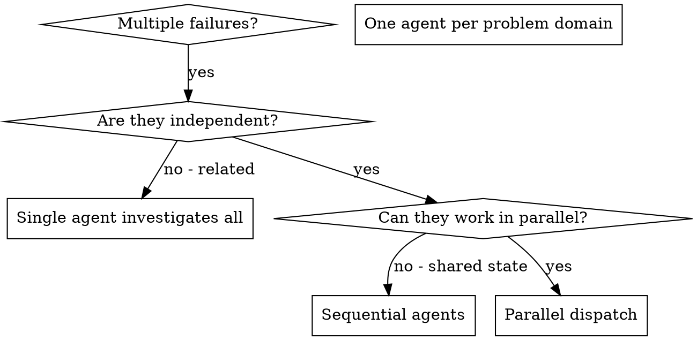

# Dispatching Parallel Agents

## Mandatory References

Before dispatching, load:
1. `.claude/skills/delegate/SKILL.md` — how to route each branch, the fan-out budget and the brief lines

## Invoked Skills

This skill invokes /delegate per branch BEFORE dispatch to pick the branch's model and effort, and /subagent-prompt per branch to write the brief. No other skills called.

| Skill | When |
|-------|------|
| `/delegate` | Per branch BEFORE dispatch to pick the branch's model, effort and fallback chain |
| `/subagent-prompt` | Per branch to write the brief (6-section template, brief lines, capped output) |

**HARD GATE — fan-out budget.** At most **3 branches at once**, and about **12 subagents in the whole session** (`/delegate`'s `fanout`; `.claude/settings.json` sets a hard ceiling of 4 concurrent). More independent items than that is a sign the work should be batched into fewer, larger branches, or done inline, not fanned wider. Each branch re-establishes context and returns a report the main session must read: in testing, eight parallel research branches cost about 50% more overall than one, and finished no sooner.

**HARD GATE — route every branch.** Before dispatching any branch, consult `/delegate` for its model and effort. Never hardcode the model.

**HARD GATE — full protocol, not a linter score.** When branches evaluate N targets (gap-analysis, audits, quality reviews), each branch runs the evaluation the brief names. NEVER substitute a structural linter (sgs-skillscore, docscore, lighthouse score) for it: a high linter score is evidence the scaffold is intact, not that there are no gaps. If a branch returns "no findings" suspiciously fast, spot-check its target yourself inline before deciding whether a re-dispatch is worth it.
## Goal

Two or more independent tasks complete concurrently with each branch routed to its own best-fit model, so heterogeneous work runs as fast as the longest branch rather than the sum of all branches.

## System Effect (5-lens)

1. **End-result.** Multiple independent investigations complete in wall-clock parallel instead of serial. Outcome: total time drops from sum-of-branches to max-of-branches.
2. **Cross-context reach.** The same parallel-dispatch pattern runs from the main session or a headless `claude -p` run; long code-only branches can run as cloud sessions (`/delegate` routes them).
3. **Bounded cost.** The fan-out budget and capped reports keep the main session's reading load small, which is where most of the cost of parallel work lands.
4. **Automation vs human-remember.** Model selection delegates to `/delegate` (not "remember the hierarchy"). The fan-out budget lives in the routing table and the concurrency ceiling in `.claude/settings.json`, not in a mental rule.
5. **ADHD / overwhelm.** Parallel dispatch is cognitively cheaper than serial when Bean is watching — one status summary at the end vs N interruptions. No veto.

## Overview

You delegate tasks to specialised agents with isolated context. By precisely crafting their instructions and context, you keep them focused. **They never inherit your session's context or history — you construct exactly what each one needs.** This also preserves your own context for coordination work.

When you have multiple unrelated failures (different test files, different subsystems, different bugs), investigating them sequentially wastes time. Each investigation is independent and can happen in parallel.

**Core principle:** Dispatch one agent per independent problem domain. Let them work concurrently. Each branch selects its own model via `/delegate` so heterogeneous work gets heterogeneous routing.

## Per-branch model selection

Before spawning the parallel branches, call `/delegate` for EACH branch independently with that branch's own task descriptor:

```bash
python .claude/skills/delegate/scripts/route.py route --task-shape <branch-shape> ...
```

Do not assume all branches use the same model. A "find every caller in 3 modules and fix one bug" workload may route the 3 lookups to Haiku at medium effort and the fix to Sonnet. Haiku suits bounded find-and-list branches; do not use a wide set of Haiku branches as a research layer feeding a planner, because the planner's reading cost outweighs the saving.

## When to Use



**Use when:**
- 3+ test files failing with different root causes
- Multiple subsystems broken independently
- Each problem can be understood without context from others
- No shared state between investigations

## When NOT to use

- **Single-branch work** — inline main thread handles it; parallel overhead isn't worth it
- **Tasks with shared state / sequential reasoning** — use `subagent-driven-development` instead (implementer + spec-reviewer + quality-reviewer per task)
- **Picking which model to use per branch** — call `/delegate` for each branch independently; this skill coordinates branches but doesn't select models
- **Writing the individual cold prompts** — use `subagent-prompt` (6-section template)
- **Connected reasoning chain** — if branches need to reference each other's work mid-flight, they aren't independent; use `subagent-driven-development` or inline
- **More branches than the fan-out budget (3 at once, about 12 a session)** — merge items into fewer, larger branches, or work inline
- **Parallel branches are fix-shape implementations from an unvalidated council** — use `/qc-council` upstream first so each branch carries an experiment frame (hypothesis + baseline + predicted post-fix + commit gate) into its cold prompt. Dispatching unvalidated fix shapes in parallel risks N parallel no-ops burning before any single result lands

**Don't use when:**
- Failures are related (fix one might fix others)
- Need to understand full system state
- Agents would interfere with each other

## The Pattern

### 1. Identify Independent Domains

Group failures by what's broken:
- File A tests: Tool approval flow
- File B tests: Batch completion behaviour
- File C tests: Abort functionality

Each domain is independent - fixing tool approval doesn't affect abort tests.

### 2. Create Focused Agent Tasks

Each agent gets:
- **Specific scope:** One test file or subsystem
- **Clear goal:** Make these tests pass
- **Constraints:** Don't change other code
- **The three brief lines from `/delegate`**, word for word, starting with the pacing line: "Time matters here: do not spend time that can be avoided, and the earlier a correct result is obtained, the better."
- **Expected output, capped:** Root cause and changes in under 150 words

### 3. Dispatch in Parallel

Issue all the branch dispatches in the SAME response — that is what makes them run concurrently:

```text
Agent (general-purpose, model: sonnet, effort: medium): "Fix agent-tool-abort.test.ts failures"
Agent (general-purpose, model: sonnet, effort: medium): "Fix batch-completion-behavior.test.ts failures"
Agent (general-purpose, model: sonnet, effort: medium): "Fix tool-approval-race-conditions.test.ts failures"
# All three run concurrently: the most this skill dispatches at once.
```

**Multiple dispatch calls in one response = parallel execution. One call per response = sequential.** This is the whole mechanism — a branch dispatched in a later turn cannot overlap one from an earlier turn.

### 4. Review and Integrate

When agents return:
- Read each summary
- Verify fixes don't conflict
- Run full test suite
- Integrate all changes

## Agent Prompt Structure

Good agent prompts are:
1. **Focused** - One clear problem domain
2. **Self-contained** - All context needed to understand the problem
3. **Specific about output** - What should the agent return?

```markdown
Time matters here: do not spend time that can be avoided, and the earlier a correct result is obtained, the better. Match your checking to the risk: a low-risk change needs one real check that exercises it, not layers of review. Return only what the caller needs: findings or results with file paths, no narrative of what you did.

Fix the 3 failing tests in src/agents/agent-tool-abort.test.ts:

1. "should abort tool with partial output capture" - expects 'interrupted at' in message
2. "should handle mixed completed and aborted tools" - fast tool aborted instead of completed
3. "should properly track pendingToolCount" - expects 3 results but gets 0

These are timing/race condition issues. Your task:

1. Read the test file and understand what each test verifies
2. Identify root cause - timing issues or actual bugs?
3. Fix by:
   - Replacing arbitrary timeouts with event-based waiting
   - Fixing bugs in abort implementation if found
   - Adjusting test expectations if testing changed behavior

Do NOT just increase timeouts - find the real issue.

Return: root cause and what you changed, under 150 words.
```

## SGS-BEM Convention (Spec 00 §3.1)

Every cold prompt this skill produces or dispatches MUST require the SGS-prefixed BEM convention (`sgs-<block>__<element>--<modifier>` (class-attribute form; the dot appears only in CSS selectors)) when the dispatched task emits class names. Without explicit injection, subagents fall back to training-default ad-hoc class names (e.g. `.hero-section`, `.cta-button`) and the recogniser pipeline silently drifts off-canonical.

Validation regex: `^sgs-[a-z][a-z0-9-]*(__[a-z][a-z0-9-]*)?(--[a-z][a-z0-9-]*)?$`. The `/sgs-clone` Stage 0 pre-flight gate hard-rejects non-conforming drafts on production runs.

Canonical reference: `.claude/specs/00-naming-conventions.md` §3.

## Common Mistakes

**❌ Too broad:** "Fix all the tests" - agent gets lost

**✅ Specific:** "Fix agent-tool-abort.test.ts" - focused scope

**❌ No context:** "Fix the race condition" - agent doesn't know where

**✅ Context:** Paste the error messages and test names

**❌ No constraints:** Agent might refactor everything

**✅ Constraints:** "Do NOT change production code" or "Fix tests only"

**❌ Vague output:** "Fix it" - you don't know what changed

**✅ Specific:** "Return root cause and changes in under 150 words"

**❌ Fanning out wide:** one branch per file across 20 files

**✅ Batched:** 3 branches, each owning a coherent group of files

**❌ Re-dispatching to double-check:** a second agent to verify the first one's routine fix

**✅ One check:** run the full suite yourself once the branches return

## Real Example from Session

**Scenario:** 6 test failures across 3 files after major refactoring

**Failures:**
- agent-tool-abort.test.ts: 3 failures (timing issues)
- batch-completion-behavior.test.ts: 2 failures (tools not executing)
- tool-approval-race-conditions.test.ts: 1 failure (execution count = 0)

**Decision:** Independent domains - abort logic separate from batch completion separate from race conditions

**Dispatch:**
```
Agent 1 → Fix agent-tool-abort.test.ts
Agent 2 → Fix batch-completion-behavior.test.ts
Agent 3 → Fix tool-approval-race-conditions.test.ts
```

**Results:**
- Agent 1: Replaced timeouts with event-based waiting
- Agent 2: Fixed event structure bug (threadId in wrong place)
- Agent 3: Added wait for async tool execution to complete

**Integration:** All fixes independent, no conflicts, full suite green

**Time saved:** 3 problems solved in parallel vs sequentially

## Verification

After agents return:
1. **Review each summary** - Understand what changed
2. **Check for conflicts** - Did agents edit same code?
3. **Run full suite** - Verify all fixes work together
4. **Spot check** - Agents can make systematic errors

