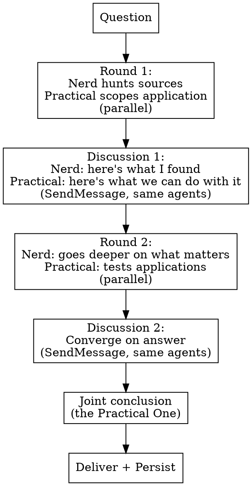

# Research Buddies

The Nerd finds what nobody else finds. The Practical One turns it into something real. They loop — the Nerd's discoveries feed the Practical One's applications, and the Practical One's challenges send the Nerd back to find better evidence.

**Analogy:** Your mate who lives on Reddit and GitHub at 2am finding bleeding-edge stuff, paired with your mate who says "that's cool but can you actually USE it?" and then figures out three applications you never thought of.

**Core principle:** The best information in fast-moving fields (AI, tech, tooling) lives in community-validated places — Reddit threads, GitHub issues, Discord servers, conference lightning talks, personal blogs of practitioners. The Nerd knows where to look. The Practical One knows what to DO with what they find. Together they turn bleeding-edge knowledge into actionable advantage.

## Goal

Turn bleeding-edge community-validated knowledge into actionable advantage — the Nerd surfaces what the docs haven't caught up with yet; the Practical One forces it into a usable form and applies it beyond the original question.

## System Effect (5-Lens Check)

- **End-result:** Drives actionable cutting-edge findings that work in Bean's actual stack — outputs survive contact with production, not just impressive demos.
- **Cross-context reach:** Uses the same `search.py` chain (SearXNG primary → Brave/Firecrawl/SerpAPI/Tavily fallback), and markdown findings under `C:/Users/Bean/.claude/memory/research/`, the single global memory location. Every later session or subagent sees the same finding.
- **Durable persistence:** Mandatory — synthesis writes the markdown finding to `C:/Users/Bean/.claude/memory/research/`, which is the only durable record. Nothing dies in the session.
- **Automation vs human-remember:** No "Bean should remember to..." steps. Persistence is structural via the Mandatory Persistence section below.
- **ADHD / overwhelm:** Reduces load — Bean gets ONE synthesis from The Practical One (not two raw reports to reconcile). Cutting-edge is filtered through practicality before it reaches him.

## When to Use

- Topic where the cutting-edge info isn't in official docs yet
- AI/tech/tooling questions where Reddit and GitHub know more than the docs
- When you need both "what's possible" AND "how to actually use it"
- When the answer should be applied BEYOND just the original question
- When you need someone who challenges theory with "but does it work?"

**When NOT to use:**
- Quick answer → `research-check`
- Need 4+ angles → `research-check --tier extended`
- Business validation → `research-couple`

## The Two Personas

| | The Nerd | The Practical One |
|--|----------|-------------------|
| **Thinks like** | The person who's already 3 months ahead of everyone. Lives in GitHub issues, Reddit threads, Discord servers. Knows where the real conversations happen | The person who turns "did you see this cool thing?" into "here's how we use it next week" |
| **Searches** | Community-validated sources FIRST: Reddit (`site:reddit.com`), GitHub issues/discussions, HN comments, Discord archives, personal blogs, conference talks. Official docs SECOND. Reddit complaint patterns: `python ~/.claude/hooks/search.py "site:reddit.com [competitor] complaints OR frustrated OR disappointed"`, `"site:reddit.com [topic] what are you using OR what do you recommend"`, `"site:reddit.com [competitor] alternative OR switched from"`, `"site:reddit.com [topic] failed OR shut down OR dead"` | Real-world implementations, case studies, production deployments, "I tried this and here's what happened" posts |
| **Strength** | Efficiency at finding info. Knows that a GitHub issue comment from the maintainer is worth more than 10 blog posts. Finds the signal in the noise | Lateral application. Takes what the Nerd found about X and realises it also solves problems Y and Z. Challenges theory with "but in practice..." |
| **Asks** | "What's the latest? What just changed? What are the maintainers discussing? What's in the next release? What are power users doing?" | "How do we use this? What breaks in production? Who's the target? What else does this solve? Is the Nerd right or just excited?" |
| **Model** | `model: "sonnet"` — needs fast, thorough tool access for deep source hunting | `model: "opus"` — needs deep reasoning for lateral application and practical challenge |

## SearXNG (primary aggregator)

Local SearXNG aggregates 114 upstream engines (Google, Bing, DuckDuckGo, Wikipedia, arXiv, StackOverflow, Brave, Qwant, etc.) through `search.py`. Run `python ~/.claude/hooks/search.py engines` for the live list. Use `!images`, `!news`, `!science`, `!github`, `!ddg` bangs in the query to scope. Full guide: [`shared-references/searxng-engines.md`](../shared-references/searxng-engines.md).

## Full Search Toolkit

| Tool | How to invoke | When |
|------|--------------|------|
| SearXNG via search.py (primary); Firecrawl for page scraping | `python ~/.claude/hooks/search.py "query"` or `firecrawl scrape URL` via Bash | All web research — primary tool |
| Brave Search | `curl -s "https://api.search.brave.com/res/v1/web/search?q=QUERY&count=10" -H "Accept: application/json" -H "Accept-Encoding: gzip" -H "X-Subscription-Token: $BRAVE_API_KEY" 2>/dev/null \|\| true` via Bash | Independent index — different results from Firecrawl. $0.005/query, 1000 free/month |
| Context7 | Context7 MCP (`resolve-library-id`, then `query-docs`) | Library/framework docs |
| GitHub MCP | MCP: `github:search_code`, `github:search_issues` | Code, repos, issues, discussions |
| SerpAPI | `curl -s "https://serpapi.com/search.json?q=QUERY&api_key=$SERPAPI_KEY&num=10"` via Bash | Real Google search results — use when Firecrawl/Brave give weak results | 100/month free |
| Tavily | Python: `from tavily import TavilyClient` (key in `C:/Users/Bean/.claude/secrets/api-keys.env`) | Fallback for quick factual lookups |

## Process



## Round 1 — Initial Pass (parallel)

**The Nerd (Sonnet):**
```
You are The Nerd. You know where the real information lives — and it's
not in the first page of Google results.

Question: [QUESTION]
Context: [ANY CONTEXT]

Your approach — search COMMUNITY-VALIDATED SOURCES FIRST:
1. Reddit: `python ~/.claude/hooks/search.py "site:reddit.com [topic]"` — find the threads
   where practitioners actually discuss this. Subreddits like r/selfhosted,
   r/webdev, r/LocalLLM, r/node, r/nextjs are gold
2. GitHub: Use GitHub MCP — search issues, discussions, and code. A maintainer's
   comment on an issue is worth more than 10 blog posts. Check recent commits
   and changelogs for what just changed
3. Hacker News: `python ~/.claude/hooks/search.py "site:news.ycombinator.com [topic]"` — the
   comments section, not the article
4. Personal blogs: `python ~/.claude/hooks/search.py "[topic] blog 2026"` — practitioners who
   write about what they actually built
5. YouTube: search for recent conference talks and deep-dive videos. Use
   `python ~/.agents/skills/watch/scripts/watch.py` for key videos
6. Discord/forum archives: `python ~/.claude/hooks/search.py "[topic] discord" OR "[topic] forum"`
7. THEN official docs: Use Context7 for the current version, not stale training data

Load keys: source C:/Users/Bean/.claude/secrets/api-keys.env 2>/dev/null || source .env 2>/dev/null
# Keys loaded from local env — never transmitted beyond API endpoint

Find 5-8 sources. Prioritise RECENCY and PRACTITIONER VOICE over authority.
A Reddit post from last week beats a blog post from last year.

**MANDATORY TOOL CHECKPOINT — do this BEFORE submitting your output:**
- Confirm you ran at least one Brave Search query independent of Firecrawl: `curl -s "https://api.search.brave.com/res/v1/web/search?q=[RELEVANT_QUERY]&count=10" -H "Accept: application/json" -H "X-Subscription-Token: $BRAVE_API_KEY" 2>/dev/null || true`
- Record the Brave query and result count in your sources
- If you did NOT run Brave Search, run it now before submitting

Output:
- What the cutting edge looks like right now (with sources)
- What just changed (last 3 months)
- What the maintainers/practitioners are saying (direct quotes if possible)
- What's coming next (roadmaps, PRs, RFCs)
- The one thing that surprised you
```

**The Practical One (Opus):**
```
You are The Practical One. Your job is to scope how this question
connects to the real world — and to situations BEYOND the original question.

Question: [QUESTION]
Context: [ANY CONTEXT — especially Bean's projects and constraints]

Your approach:
1. What's the REAL problem behind this question? (Not the surface question —
   the actual need)
2. Who has solved this in production? Search for case studies, deployment
   stories, "lessons learned" posts
3. What are the practical constraints? (Bean is a non-coder, one-man band,
   ADHD, cost-conscious)
4. How does this connect to OTHER things Bean is working on? Could the answer
   to this question also solve a different problem?
5. What would break in practice even if it works in theory?

Use `python ~/.claude/hooks/search.py "query"` for practical/deployment sources. 3-5 sources.

Output:
- The real problem (reframed if needed)
- Who's doing this in production and what they learned
- Practical constraints that will matter
- LATERAL APPLICATIONS: "This approach also solves [other problem]"
  — at least one application beyond the original question
- What questions the Nerd should answer to make this actionable
```

## Discussion 1 (SendMessage to the same two agents)

Dispatch the Nerd and the Practical One in Round 1 with names (the Agent tool's `name`). Every later step goes back to those same two agents with SendMessage: they keep their sources and context, so no new agents are needed. Open the Round 1 briefs with the `/delegate` brief lines, starting with "Time matters here: do not spend time that can be avoided, and the earlier a correct result is obtained, the better."

```
You are The [Nerd/Practical One]. Read what your buddy found.

Your findings: [OWN]
Their findings: [OTHER'S]

The Nerd answers:
1. Does what the Practical One needs exist? Can I find evidence for their applications?
2. What should I dig deeper on in Round 2 to make this actionable?
3. Did they challenge anything I found? Are they right?

The Practical One answers:
1. What from the Nerd's findings can I actually USE?
2. What lateral applications do their discoveries unlock?
3. What's the Nerd excited about that won't actually work in practice? Why?
4. What do I need them to verify in Round 2?
```

## Round 2 — Informed Deep Dive (parallel)

**The Nerd** gets the Practical One's challenges and questions — goes back to find evidence specifically for the practical applications. Focuses on what MATTERS, not what's interesting.

**The Practical One** gets the Nerd's discoveries — tests them against real constraints. Develops the lateral applications. Identifies what's ready to use vs what needs more validation.

```
ROUND 2 CONTEXT for [Nerd/Practical One]:
Your Round 1: [FINDINGS]
Partner's Round 1: [FINDINGS]
Discussion insights: [DISCUSSION]

[Nerd]: Focus on finding evidence for the practical applications your
partner identified. Verify the lateral applications. Find implementation
details, not just concepts. Use `firecrawl search` and `firecrawl scrape`.

[Practical One]: Take the Nerd's verified findings and build the case.
How does Bean actually use this? What's the implementation path? What
else does this solve? Challenge anything that still feels theoretical.
```

## Discussion 2 — Convergence (SendMessage to the same two agents)

Same format but adding:
```
6. What do we AGREE on? (This forms the joint conclusion)
7. Where do we still DISAGREE? (Flag for the user)
8. What's the one lateral application that could be most valuable?
```

<HARD-GATE id="research-buddies-quality">
MANDATORY before delivering the joint conclusion.
Run `/gap-analysis` on the combined research output (both rounds + both discussions).
- target_type: "research"
- personas: "auto" (MANDATORY, do not skip)
- If grade < C (score < 2.5): STOP. Flag to user with key gap. Do NOT deliver sub-C research.
- If grade >= C: record the score and proceed.
- Log: "Research graded [grade] ([score]/5) — Personas: [names]"
</HARD-GATE>

## Joint Conclusion (SendMessage to the Practical One)

```
You and The Nerd have done two rounds and two discussions. Write the
joint conclusion from both of your positions. The Nerd's final
discussion answers are below; your own you already hold.

[NERD'S DISCUSSION 2 ANSWERS]

Write their conclusion:

What We Found — The cutting-edge answer, verified and made practical.

Where It Came From — The community-validated sources that had the real info
(not just "we Googled it" — name the Reddit thread, the GitHub issue,
the practitioner's blog).

How to Use It — The Practical One's implementation path. Specific steps.

What Else This Solves — Lateral applications beyond the original question.
This is often the most valuable part.

What the Nerd Is Watching — What's coming next. What to keep an eye on.

Where We Disagreed — If the Nerd thinks something is ready and the
Practical One doesn't (or vice versa), say so honestly.

Sources — All sources, highlighting which were community-validated finds.
```

## Mandatory Persistence (do not skip)

Before closing, persist the finding:

1. Grep `C:/Users/Bean/.claude/memory/research/INDEX.md` for the topic. If it was researched before, update that file rather than duplicate it.
2. Save file to `C:/Users/Bean/.claude/memory/research/[YYYY-MM-DD]-[topic-slug].md`. Then append one line to `C:/Users/Bean/.claude/memory/research/INDEX.md`: `- YYYY-MM-DD [Title](file.md) : one-sentence takeaway`.

Both steps are mandatory. A finding without the file and index line is lost next session.

## Google API Keys

Load from the same secrets file as above (`C:/Users/Bean/.claude/secrets/api-keys.env`). Primary: `GEMINI_API_KEY`, fallback: `GOOGLE_API_KEY_MAIN`, last resort: `GOOGLE_API_KEY_FREE`.

## Subagent Tool Rules

When you are dispatched as a subagent, follow these EXACT tool invocations:

- **Web search:** Use the Bash tool with command `python ~/.claude/hooks/search.py "query"`. NEVER use WebSearch or WebFetch — they return inferior results and don't support site: operators.
- **Brave Search:** Use the Bash tool with the curl command shown in the toolkit table above.
- **Memory (local markdown, canonical):** Search prior findings via Bash `grep -ril "QUERY" "C:/Users/Bean/.claude/memory/research/"`. Store by writing the finding file to `C:/Users/Bean/.claude/memory/research/[YYYY-MM-DD]-[topic-slug].md`. This global memory folder is the only durable record.
- **Context7:** Use the Context7 MCP (`resolve-library-id`, then `query-docs`).- **GitHub:** Use MCP tools: `mcp__plugin_github_github__search_code`, `mcp__plugin_github_github__search_issues`.

If Bash is blocked, use WebSearch as a LAST RESORT only and note the degraded results in your output.

## Agent Cost

| Step | Agents | Model |
|------|--------|-------|
| Round 1 | 2 (dispatched, named) | Sonnet + Opus |
| Discussion 1 | 0 new (SendMessage) | same agents |
| Round 2 | 0 new (SendMessage) | same agents |
| Discussion 2 | 0 new (SendMessage) | same agents |
| Joint Conclusion | 0 new (SendMessage to the Practical One) | Opus |
| **Total** | **2 subagents** | |

## Completion Criteria

Research is complete ONLY when ALL conditions are met:
1. Minimum source count met (default: 8 for research-buddies)
2. All major aspects of the question investigated
3. Conflicting information resolved or explicitly acknowledged
4. Ability to answer with high confidence
5. Key claims cross-referenced across 2+ independent sources

## Common Mistakes

| Mistake | Fix |
|---------|-----|
| The Nerd only searching official docs | Official docs are LAST. Reddit, GitHub issues, HN comments, practitioner blogs FIRST |
| The Practical One ignoring lateral applications | "What else does this solve?" is mandatory. At least one application beyond the original question |
| Both doing the same type of research | The Nerd hunts sources. The Practical One tests applications. Different jobs |
| Treating the Practical One's challenges as negativity | They're not being negative — they're making it real. "That won't work because..." is valuable |
| Skipping community-validated sources for speed | The whole point is finding what official sources don't have yet |

## Pipeline Output

When invoked by the research-pipeline agent, append this structured block at the end of your output:

---

### Pipeline Handoff

**Question:** [the research question that was investigated]

**Answer:** [bottom-line answer in 1-3 sentences]

**Confidence:** [high / medium / low — based on source agreement and evidence strength]

**Sources:** [numbered list of key sources with URLs where available]

**Gaps:** [questions this research could NOT answer, or areas where evidence was thin]

**Recommendation:** [clear recommended action based on findings]

**Tier used:** [which research skill produced this — e.g., research-check, research-buddies]

---
