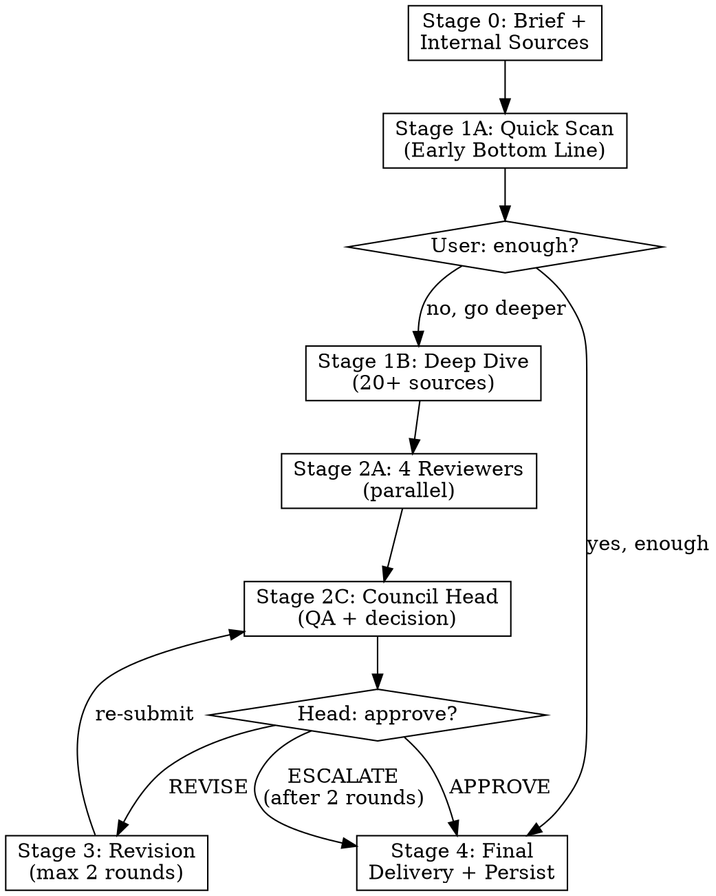

# Deep Research Council

Rigorous multi-stage research with mandatory source verification, multi-reviewer council review with a Council Head, and ADHD-friendly output.

**Core principle:** No factual claim without a source. No research without counter-evidence. No review without accountability.

**Stages:** Stage 0 BRIEF → Stage 1 RESEARCH (1A quick scan, 1B deep dive) → Stage 2 COUNCIL (2A reviewers, 2B cross-read, 2C Council Head) → Stage 3 REVISION (conditional) → Stage 4 DELIVER + PERSIST

## Goal

Produce a peer-reviewed research survey with formal accountability — multiple biased researchers, a cross-read round, and a Council Head with scoring and revision power — for deliverables that need 10+ sources and won't pass scrutiny without fact-checking.

## Invokes

Dispatches `Agent` calls directly: one Sonnet researcher (continued by SendMessage from quick scan to deep dive), four reviewers whose cross-read round goes back to the same agents by SendMessage, and an Opus Council Head. Six subagents in all, within the hard ceiling of 4 running at once that `.claude/settings.json` sets. Every brief opens with the `/delegate` brief lines, starting with "Time matters here: do not spend time that can be avoided, and the earlier a correct result is obtained, the better." Does not invoke other skills mid-execution. Delegates persistence to research markdown files.

## Mandatory References

Before running, load:
1. [`references/shared-references/communication-standards.md`](references/shared-references/communication-standards.md) — plain-English + ADHD-friendly output rules.
2. [`references/research-toolkit.md`](references/research-toolkit.md) — the full Stage 1 toolkit: source hierarchy with Reddit templates, deep-dive tool table, mandatory research requirements, failure modes, subagent tool rules. **Every dispatched researcher prompt embeds or points to this file.**

## SearXNG (primary aggregator)

Local SearXNG aggregates 114 upstream engines (the count comes from `python ~/.claude/hooks/search.py engines` — run that for the live list) through `search.py`. Use `!images`, `!news`, `!science`, `!github`, `!ddg` bangs in the query to scope. Full guide: [`references/shared-references/searxng-engines.md`](references/shared-references/searxng-engines.md).

## System Effect (5-Lens Check)

- **End-result:** A peer-reviewed research report with 10+ sources and Council Head sign-off — output that holds up to client scrutiny without follow-up questions.
- **Cross-context reach:** Findings persist as markdown under `C:/Users/Bean/.claude/memory/research/`, the single global memory location. Every later session or subagent reads the same verdict.
- **Persistence:** Mandatory at Stage 4 — the dated markdown file.
- **Automation vs human-remember:** The Council Head's revision loop is automated via re-dispatch, not "Bean fixes it manually."
- **ADHD / overwhelm:** Output is the ADHD-formatted final report (TL;DR → key findings → detail). Bean reads the TL;DR; deeper layers are available, not forced.

## When to Use

- User requests deep research, thorough analysis, or comprehensive strategy
- Any deliverable requiring 10+ sources and proper references
- Topics needing multiple expert perspectives
- Decisions where shallow research has caused problems before

**When NOT to use:**
- Quick factual lookups → `research-check` or `/search`
- Code-only questions → Explore agent or `code-explorer`
- Single-source answers → read the docs directly
- Business idea validation → `research-couple`
- Cutting-edge + practical balance → `research-buddies`
- High-stakes strategic decisions → `deep-research`
- Council output includes two or more actionable fix-shape proposals needing empirical pre/post measurement → route them through `/qc-council` after this skill completes (every proposal clears the empirical-validation gate before any subagent implements it)

## Process Flow



## Stage 0 — Brief and Internal Sources

**Run in main thread.**

1. **Create research brief** from user request: Topic, Scope, Deliverable format, Audience, Success criteria. Present to user for confirmation.

2. **Check internal sources first** (main thread — skills like `episodic-memory` can't run from dispatched agents):

   | Source | How to check |
   |--------|-------------|
      | Existing research docs | Glob `C:/Users/Bean/.claude/memory/research/` for topic matches, Read relevant files |
   | Discord discussions | `discord` MCP `discord:read-messages` in relevant channels |
   | Voice notes | `whisper-mcp:transcribe_audio` (only if user points to audio) |
   | YouTube summaries | Check `~/.claude/memory/research/` for existing video analysis |

   For new YouTube videos on the topic: `/youtube-transcript` for quick transcript extraction, or `watch.py` for full audio+visual analysis (the sanctioned video exception — Gemini only because Claude cannot ingest video).

   If the user doesn't confirm the brief or says "just get on with it" — proceed with reasonable defaults. The brief is for alignment, not a gate.

3. **Summarise internal findings.** If internal sources already cover the topic well, ask whether to proceed with external research or synthesise what exists.

## Stage 1 — Deep Research

Dispatch via the `Agent` tool with `model: "sonnet"`, using the prompts in `researcher-prompt.md`. Every researcher prompt carries the **source hierarchy, tool table, mandatory requirements, and failure modes from [`references/research-toolkit.md`](references/research-toolkit.md)** — community-validated sources (Reddit, GitHub, HN, practitioner blogs) are searched FIRST, official docs last.

### Stage 1A — Quick Scan (ADHD-friendly early value)

Fast initial scan: 5-7 top sources, 3-5 searches maximum. Produces an **Early Bottom Line** (2-3 sentences) delivered to the user immediately.

If that answers the question, stop here: deliver in short-form format (skip Council Scores, omit Trade-offs if not applicable), then persist as in Stage 4.

### Stage 1B — Deep Dive

The **same** researcher continues by SendMessage (it keeps its sources and context; pass any internal findings in the message) and conducts exhaustive research per the toolkit reference. Non-negotiables (full detail in the toolkit):

- **Source depth targets:** Moderate (10-15) for well-understood topics; Deep (20+) for unfamiliar/strategic; Exhaustive (30+) when the user asks for maximum rigour.
- **Every source tiered** (Tier 1 official/peer-reviewed → Tier 4 anecdotal); citation format `[Source: Author/Org, "Title", URL, Date, Tier X]`.
- **Counter-research and complaint research are mandatory**, not optional.
- **Every factual claim** goes through the Google Fact Check API (empty result = "no data", not "false") and 3+ source cross-reference.
- **Brave Search checkpoint:** at least one Brave query independent of the primary engine, recorded in sources.

**Output:** structured report with inline references, tiers, confidence levels, counter-evidence section, compiled bibliography.

## Stage 2 — Expert Council Review

### Stage 2A — Four Reviewers in Parallel

Dispatch all four simultaneously (`dispatching-parallel-agents` pattern). **Three of the four are ACTIVE researchers** — they bring their own evidence, not just opinions.

| Role | Model | Active research? | Focus |
|------|-------|-----------------|-------|
| **Research Analyst** | `model: "opus"` | **YES** — verifies claims at source, fills gaps | Accuracy, completeness, feasibility. Spot-checks citations |
| **Sceptic** | `model: "opus"` | **YES** — hunts counter-evidence, failure stories | Disprove claims, expose bias. Searches "[topic] problems/failed/vs". **The most important role** |
| **Optimiser** | `model: "sonnet"` | **YES** — hunts alternatives, cheaper/newer options | "Can we do this better/cheaper/faster?" Searches "[topic] alternative/open source/2026" |
| **User Advocate** | `model: "sonnet"` | No — evaluates format/clarity only | ADHD-friendliness, audience fit, 5-second rule, actionability |

Each reviewer receives the full research report + original brief. Each ACTIVE reviewer must: bring 3-5 new sources; score six dimensions 1-10 (Accuracy, Completeness, Practicality, Clarity, References, Source Quality); quote specific problematic text; state APPROVE or REQUEST REVISION. The Sceptic must land at least one substantive evidenced challenge; the Optimiser at least one concrete sourced alternative. Full templates: `council-prompts.md`.

### Stage 2B — Cross-Read Round

After all four return, send each reviewer the three other reviews with SendMessage to its name (name each reviewer when you dispatch it in Stage 2A). The reviewer keeps its own evidence and context, so no new agents are needed. Each answers: does anything change your assessment? Can you weaken another reviewer's point? Final position: Reinforced, Pivoted, or Conflicted? It turns four monologues into a discussion before the Head sees them, and costs four messages rather than four new subagents.

### Stage 2C — Council Head

Sequential, after the cross-read. `Agent` with `model: "opus"`. Persona: senior research director with zero tolerance for lazy work. Receives the report + four reviews + four cross-reads.

**Authority:** QAs the reviewers (substantive or rubber-stamp?); detects groupthink/confirmation/authority/recency bias; can reject a reviewer's report and re-dispatch with an improved prompt the Head writes; can request additional research; scores independently; makes the sole final decision — APPROVE, REVISE, or ESCALATE. Full template: `council-prompts.md`.

## Stage 3 — Revision Loop (conditional)

Triggered only by the Head's REVISE or REJECT.

- **Head REVISES the research:** Head writes a synthesised revision brief → new Sonnet `Agent` with brief + original report → re-submit to the Head only (not all reviewers). Maximum 2 rounds; still failing → Head escalates to the user.
- **Head REJECTS a reviewer's report:** Head writes an improved prompt for that reviewer → re-dispatch that reviewer → re-submit the updated review set to the Head for the final decision.

<HARD-GATE id="research-council-quality">
MANDATORY before final delivery.
Run `/gap-analysis` on the Council Head's approved output.
- target_type: "research"
- personas: "auto" (MANDATORY, do not skip)
- If grade < C (score < 2.5): STOP. Council Head must request revision. Do NOT deliver sub-C research.
- If grade >= C: record the score and proceed.
- Log: "Research graded [grade] ([score]/5) — Personas: [names]"
</HARD-GATE>

## Stage 4 — Final Delivery

**Run in main thread.**

### Mandatory ADHD Output Format (enforced, not suggested)

```
Bottom Line -- 2-3 sentences max. Core finding and recommendation.
What I Found -- Evidence-based. Sources named and tiered. Short paragraphs.
What Most People Miss -- The non-obvious insight that changes the approach.
Recommendations -- Numbered steps. Specific and actionable.
Trade-offs -- Honest about what each choice costs.
Sources -- Every claim cited with tier. Verified via Fact Check API.
Council Scores -- Aggregated scores table + dissenting opinions.
Questions for You -- Only if genuinely needed.
```

### Mandatory Persistence (do not skip)

1. Glob `C:/Users/Bean/.claude/memory/research/` first — if the topic was researched before, update that file rather than duplicating it.
2. Save the finding to `C:/Users/Bean/.claude/memory/research/[YYYY-MM-DD]-[topic-slug].md`, leading with the verdict + 3 key findings. Then append one line to `C:/Users/Bean/.claude/memory/research/INDEX.md`: `- YYYY-MM-DD [Title](file.md) : one-sentence takeaway`.

Main-thread output without that file = lost next session. The file is the only durable record.

## Agent Delegation

When research touches a specialist domain, delegate: `Explore` (tracing execution paths), `Plan` (output becomes an implementation plan), `muslim-ai-builder` (Islamic tech / Quranic data / prayer times), `wp-sgs-developer` (WordPress internals), `Explore` (quick codebase searches).

## API Keys

Load from the same secrets file as above (`C:/Users/Bean/.claude/secrets/api-keys.env`). Three-tier fallback for the Google REST APIs (Knowledge Graph, Fact Check — not LLM calls):

| Priority | Key | Access level |
|----------|-----|-------------|
| Primary | `GEMINI_API_KEY` | Google Cloud key for Knowledge Graph / Fact Check REST APIs (not an LLM call) |
| Fallback | `GOOGLE_API_KEY_MAIN` | Trial credit, paid APIs |
| Last resort | `GOOGLE_API_KEY_FREE` | Free tier only |

## Completion Criteria

Research is complete ONLY when ALL are met:
1. Minimum source count met (default: 10 for research-council)
2. All major aspects of the question investigated
3. Conflicting information resolved or explicitly acknowledged
4. Ability to answer with high confidence
5. Key claims cross-referenced across 2+ independent sources

## Common Mistakes

| Mistake | Fix |
|---------|-----|
| Reporting source count without quality | Always tier sources. 3 Tier 1 beats 20 Tier 3 |
| Skipping counter-research | Mandatory. Search for contradicting evidence deliberately |
| Council rubber-stamping | The Sceptic must challenge. The Head rejects lazy reviews |
| Delivering without persistence | Always write the dated research markdown file |
| All-or-nothing delivery | Deliver Early Bottom Line first, then deep dive if needed |
| Using WebSearch/WebFetch | Use `search.py`/Firecrawl; WebSearch only as a last resort when Bash is blocked, noting the degraded results |
| Dispatching researchers without the toolkit | Every researcher prompt embeds `references/research-toolkit.md` — source hierarchy, checkpoint, failure modes |

## Pipeline Output

When invoked by the research-pipeline agent, append this structured block at the end of your output:

---

### Pipeline Handoff

**Question:** [the research question that was investigated]

**Answer:** [bottom-line answer in 1-3 sentences]

**Confidence:** [high / medium / low — based on source agreement and evidence strength]

**Sources:** [numbered list of key sources with URLs where available]

**Gaps:** [questions this research could NOT answer, or areas where evidence was thin]

**Recommendation:** [clear recommended action based on findings]

**Tier used:** [which research skill produced this — e.g., research-council]

---
